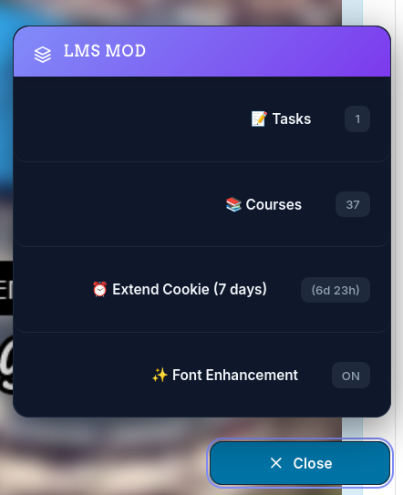
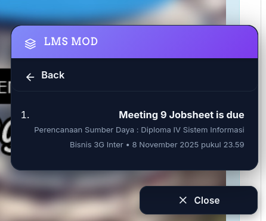
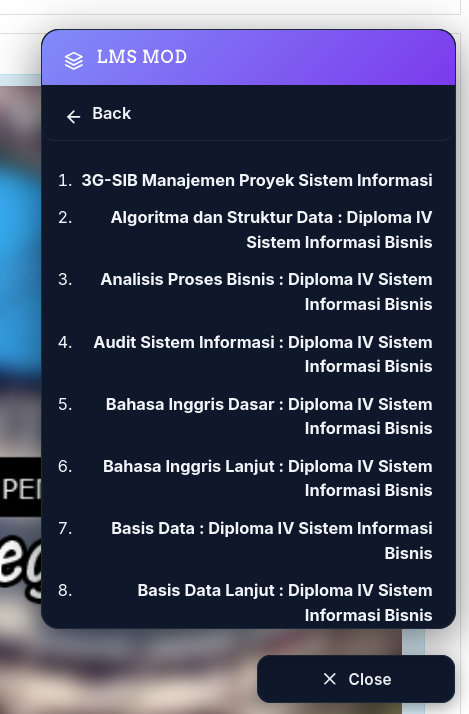

# 🎓 Polinema LMS Mod

<div align="center">



**A modern enhancement suite for Politeknik Negeri Malang's Learning Management System**

[](https://github.com/hoshigakikisame/lms-mod)
[](LICENSE)
[](https://www.tampermonkey.net/)

[Install](#-installation) • [Features](#-features) • [Screenshots](#-screenshots) • [Contributing](#-contributing)

</div>

---

## 📖 Overview

LMS Mod is a powerful Tampermonkey userscript designed to enhance the user experience of Polinema's Learning Management System. Born from a student's frustration with navigating assignments and courses, this script transforms the LMS into a more intuitive and efficient platform.

### 🎯 Why LMS Mod?

- **Hidden Assignments**: Discover all upcoming assignments, including those not prominently displayed
- **Quick Access**: Navigate to courses and tasks with a single click
- **Modern UI**: Beautiful, responsive floating menu with dark mode support
- **Time-Saving**: No more clicking through multiple pages to find what you need

## ✨ Features

<table>
<tr>
<td width="50%">

### 🎨 **Modern Interface**
- Elegant floating menu with smooth animations
- Responsive design that adapts to your screen
- Dark mode support for comfortable night studying
- Clean, minimalist aesthetic

</td>
<td width="50%">

### 📋 **Smart Organization**
- View all upcoming assignments in one place
- Complete course list with direct links
- Real-time task tracking
- Chronologically sorted deadlines

</td>
</tr>
<tr>
<td width="50%">

### ⚡ **Enhanced Features**
- Custom font enhancement option
- Extended session management
- SSO authentication support (Experimental)
- Cookie expiration extension

</td>
<td width="50%">

### 🔒 **Safe & Open**
- Open-source and transparent
- No data collection or tracking
- Community-driven development
- Regular updates and improvements

</td>
</tr>
</table>

## 📸 Screenshots

<div align="center">

### Main Menu


### Tasks View


### Courses View


</div>

## 🚀 Installation

### Prerequisites
- A modern web browser (Chrome, Firefox, Edge, Safari, Opera)
- Tampermonkey extension installed

### Step-by-Step Guide

1. **Install Tampermonkey**
   
   Visit [tampermonkey.net](https://www.tampermonkey.net/) and install the extension for your browser.

2. **Install LMS Mod**
   
   Click the button below to install the script:
   
   [](https://github.com/hoshigakikisame/lms-mod/raw/main/lms_mod.user.js)

3. **Visit Polinema LMS**
   
   Navigate to [lmsslc.polinema.ac.id](https://lmsslc.polinema.ac.id/) and enjoy your enhanced experience!

## 💡 Usage

Once installed, the script automatically activates when you visit Polinema's LMS:

1. Look for the **floating button** in the bottom-right corner
2. Click to open the menu and access:
   - 📝 All your upcoming tasks
   - 📚 Complete course list
   - ⏰ Session extension tools
   - ✨ Font enhancement toggle

## 🛠️ Development

### Tech Stack

- **JavaScript (ES6+)**: Core functionality
- **CSS3**: Modern styling with CSS variables
- **Fetch API**: Data retrieval from LMS endpoints

### Local Development

```bash
# Clone the repository
git clone https://github.com/hoshigakikisame/lms-mod.git

# Navigate to project directory
cd lms-mod

# Open in your favorite editor
code .
```

### Building from Source

The script is designed to run directly in Tampermonkey without a build process. Simply edit `lms_mod.user.js` and reload in your browser.

## 🤝 Contributing

Contributions are what make the open-source community amazing! Any contributions you make are **greatly appreciated**.

### How to Contribute

1. Fork the Project
2. Create your Feature Branch (`git checkout -b feature/AmazingFeature`)
3. Commit your Changes (`git commit -m 'Add some AmazingFeature'`)
4. Push to the Branch (`git push origin feature/AmazingFeature`)
5. Open a Pull Request

### Reporting Issues

Found a bug or have a suggestion? Please [open an issue](https://github.com/hoshigakikisame/lms-mod/issues) with detailed information.

## 📜 Changelog

### Version 2025.11.04
- ✨ Modern UI refresh with improved aesthetics
- 🎨 Enhanced color scheme and typography
- 🐛 Fixed menu visibility issues
- ⚡ Performance improvements
- 🌙 Better dark mode support

[View Full Changelog](CHANGELOG.md)

## ⚠️ Disclaimer

This script is an **unofficial** enhancement tool and is not affiliated with, endorsed by, or connected to Politeknik Negeri Malang or any of its official systems.

- ✅ **Use at your own risk**
- ✅ **No warranty or guarantee provided**
- ✅ **Not intended for malicious use**
- ✅ **Respect academic integrity policies**

The developers are not responsible for any issues, damages, or violations that may arise from the use of this script.

## 📄 License

This project is licensed under the **MIT License** - see the [LICENSE](LICENSE) file for details.

```
MIT License - Copyright (c) 2025 ferdirianrk + contributors
```